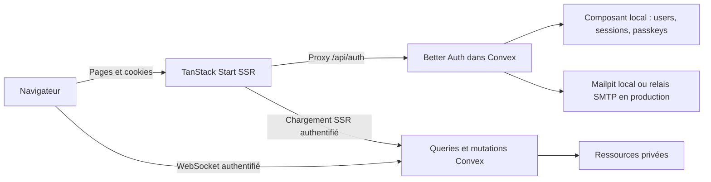

# Architecture

## Frontières

Le navigateur peut appeler Convex directement. Toute autorisation métier appartient donc au backend, indépendamment des routes et boutons visibles. Les fonctions SSR transmettent l’authentification du visiteur ; elles ne disposent pas d’une identité admin implicite.

## Organisation

| Emplacement | Responsabilité |
| --- | --- |
| `src/routes/` | Routes, chargements SSR et garde UX |
| `src/features/` | Interfaces des fonctionnalités |
| `src/components/ui/` | Composants shadcn/ui réutilisables |
| `src/lib/` | Clients, configuration validée et primitives transverses |
| `src/config/` | Navigation publique typée, sans autorisation implicite |
| `shared/app-config.ts` | Identité publique et formats communs UI/backend |
| `convex/` | Schéma, règles métier et API publique/interne |
| `convex/betterAuth/` | Composant Local Install et schéma d’auth généré |
| `scripts/` | Initialisation et génération reproductibles |
| `tests/e2e/` | Parcours navigateur avec services réels |

Ajouter un domaine fonctionnel près de ses règles. Extraire une abstraction après répétition réelle ; éviter une couche générique de repositories qui masque les indexes et transactions Convex.

## Modèle de référence

Une ressource contient un titre, une description, ses timestamps et l’identifiant de son auteur. Sans `organizationId`, elle appartient à cet utilisateur et les lectures filtrent son propriétaire via un index incluant le scope personnel. Avec `organizationId`, elle appartient à l’espace partagé : l’activation du module, la membership courante et son rôle autorisent chaque accès. L’auteur ne décide pas des droits de l’organisation. Ces identifiants sont calculés ou vérifiés depuis la session, jamais considérés comme une autorité client.

Le [module organisations](organizations.md) conserve le mode personnel par défaut. Le schéma Better Auth est stable dans les deux modes ; les opérations applicatives utilisent des mutations Convex atomiques et les routes natives du plugin sont fermées. Les rôles ne sont pas mis en cache dans une session et l’organisation choisie dans l’URL reste une proposition revalidée côté backend.

Une liste est paginée ; une mutation s’exécute dans une transaction Convex. Réserver les actions aux effets externes. Un appel email ou paiement ne doit pas faire partie d’une mutation rejouable ; prévoir idempotence et reprise pour ces effets.

La suppression d’un compte ou d’une organisation ferme ses accès et enregistre une demande `cleanupJobs` dans la même transaction. Les lots de `convex/cleanup.ts` retirent cette demande à la fin ; un cron relance les demandes inachevées, y compris après une restauration sans tâches planifiées. Garder ce contrat pour chaque domaine ajouté ; le [guide de sauvegarde](backup-restore.md) précise la limite des anciennes archives.

## Données et interface

Convex persiste ses données dans PostgreSQL 18.6 en développement local et dans le Compose prévu pour Coolify. Les accès métier et l’authentification continuent de passer par Convex ; le volume Convex conserve par défaut les fichiers, modules et indexes. En production, le Compose peut déléguer ce stockage objet à Garage/S3 sans remplacer PostgreSQL. La [décision de stockage](decisions/storage.md) et le [guide de déploiement](deployment.md) décrivent les options, la migration depuis SQLite et la séparation des environnements.

TanStack Query et son intégration Convex fournissent le chargement SSR et la cohérence des données. Ne pas recopier les résultats dans `useState`. L’état local contient le dialogue ouvert, les champs en cours de saisie et les interactions de présentation.

Les [comptes et modèles réutilisables](accounts.md) couvrent pseudos atomiques, rôles applicatifs, preuves de confirmation sensibles, quotas isolés et versions attendues des formulaires. Le composant local garde ces invariants dans les mêmes transactions que les données auth.

Le loader authentifié valide l’utilisateur et fournit son ID stable pour le document courant. Une confirmation de token en cours ne démonte pas ses pages et brouillons, même si la query utilisateur retourne temporairement `null`. Un utilisateur absent après confirmation ou une authentification refusée ferme l’interface. Si la query indique un autre compte, le layout masque l’ancien espace et recharge le document pour recréer les caches : aucun brouillon ou résultat du premier compte ne doit passer au second. Cette continuité d’interface n’autorise aucun accès backend et n’ajoute pas de cache de session.

Zod valide les formulaires à leur frontière ; les validateurs Convex restent nécessaires côté backend. Conserver des libellés accessibles, l’état de chargement, les erreurs compréhensibles et le focus des dialogues. Les composants shadcn/ui appartiennent au projet et évoluent avec ses usages.

## Évolution

Le socle est orienté application web. Une API tierce, du multi-tenant, du traitement de fichiers ou une activité IA introduisent de nouvelles frontières : les décrire dans `docs/modules.md`, définir les droits et budgets, puis implémenter un parcours vertical vérifiable.

Le [guide d’adoption](adopting.md) indique les points de personnalisation, le remplacement de la démonstration et l’ajout d’un domaine sans oublier l’export, le nettoyage du compte et la restauration. Les permissions restent dans Convex ; la configuration publique et les liens de navigation ne les modifient pas.
